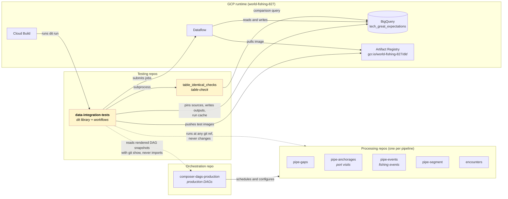
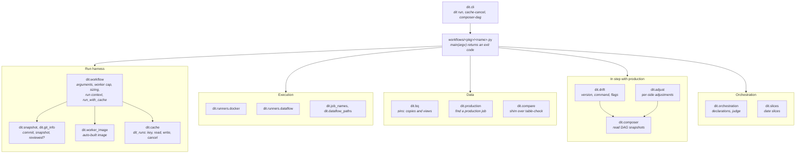
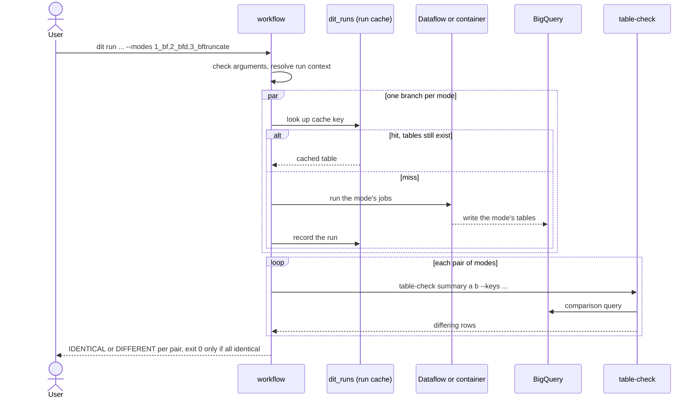
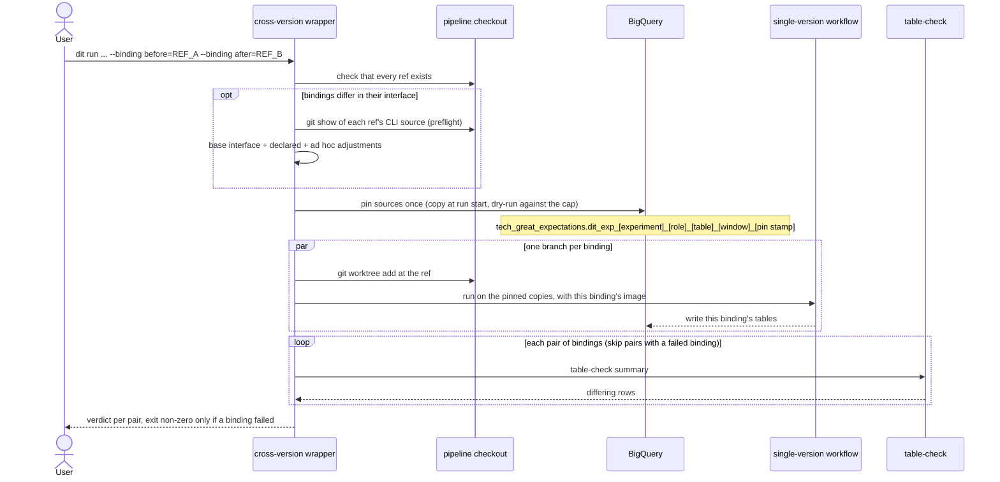
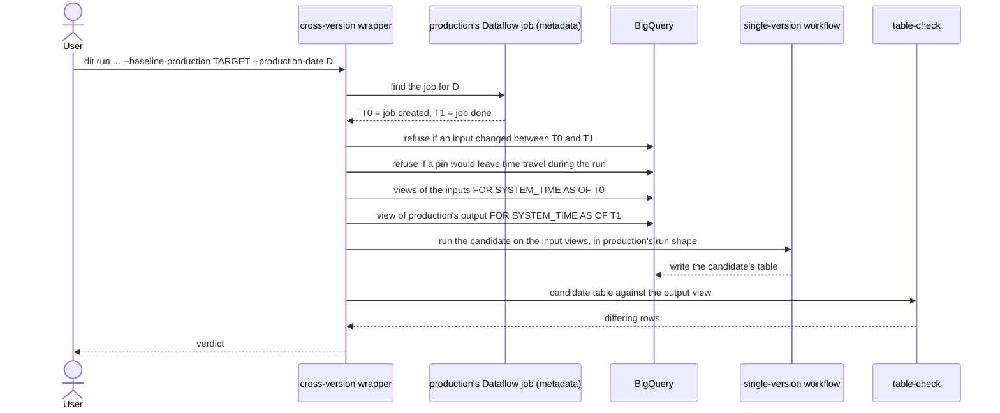
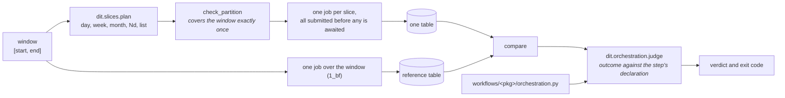
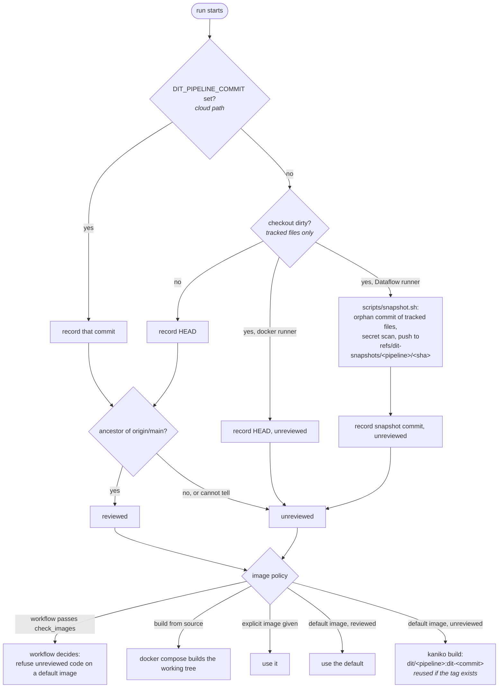
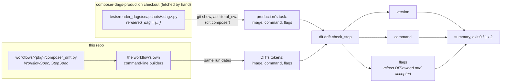

# DIT architecture

Diagrams of how the pieces fit together. Each section stands alone. The text that goes with them is in [`framework.md`](framework.md).

1. [System context](#1-system-context)
2. [The library](#2-the-library)
3. [Ways to start a run](#3-ways-to-start-a-run)
4. [Workflow flows](#4-workflow-flows)
5. [Run context: commit and image](#5-run-context-commit-and-image)
6. [Cloud Build runtime](#6-cloud-build-runtime)
7. [The drift check](#7-the-drift-check)
8. [Image namespace](#8-image-namespace)

The diagrams are Mermaid and render on GitHub. Locally, most editors render them in a Markdown preview with a Mermaid extension.

---

## 1. System context

Three kinds of repo, by owner. Pipeline repos hold the pipelines. `composer-dags-production` holds what production runs. This repo and `table_identical_checks` hold the tests.



| Owns | Repo |
|---|---|
| Pipeline code, its command line, its published images | Processing repos |
| Production DAGs and parameters | `composer-dags-production` |
| The `dit` library, the workflows, the cloud runtime | `data-integration-tests` (this repo) |
| The table comparison | `table_identical_checks` |

Dotted arrows are read-only. DIT reads production data and production DAG configuration. It writes only to its own namespaces ([`conventions.md`](conventions.md) § Prod-infra boundary).

---

## 2. The library

A workflow file holds what is specific to a pipeline: the steps' command lines, the output tables, the compare keys. Everything else comes from `src/dit/`.



Module by module: [`framework.md`](framework.md) § 14.

---

## 3. Ways to start a run

| How | Command | Use | State |
|---|---|---|---|
| By hand, locally | `dit run workflows/<pkg>/<name>.py` | Development, small cohorts, dry runs | Works |
| By hand, in Cloud Build | `make dit-cloud PIPELINE=... WORKFLOW=... ARGS="..."` | Long runs; nothing depends on a laptop staying awake | Works |
| From a pull request | A Cloud Build trigger in the pipeline repo that uses `cloudbuild-dit.yaml` | A check on the pull request | Planned |
| On a schedule | Cloud Scheduler to Cloud Build, same yaml | Nightly runs against `main` | Planned |

All four use the same `cloudbuild-dit.yaml` or the same `dit run`. Only what starts them differs.

---

## 4. Workflow flows

### 4a. Mode equivalence

One pipeline version, several ways of loading the same window. A difference fails the run.



Not every workflow uses the run cache ([`framework.md`](framework.md) § 6).

### 4b. Cross-version

Several git refs of one pipeline on the same pinned input. A difference is the result, not a failure.



Each binding needs an image that holds its own code. Otherwise all bindings run the same worker code and the comparison passes without testing anything ([`framework.md`](framework.md) § 7).

### 4c. Production baseline

One candidate against the table production wrote. Production is not re-run.



### 4d. Parallel slices



---

## 5. Run context: commit and image

What `dit.workflow.resolve_run_context` decides before any job starts.



Two simplifications in this diagram:

- In the cloud path the laptop has already answered "reviewed?" and passes it in as `DIT_UNREVIEWED`. The ancestry check runs in the build only when that variable is missing.
- A run with an explicit `--suffix` (every binding of a cross-version run) never snapshots. It records the checkout's state as it is, and counts as unreviewed when the tree is dirty or the commit is not merged.

Text: [`framework.md`](framework.md) § 7.

---

## 6. Cloud Build runtime

How `make dit-cloud` runs a workflow. The same `cloudbuild-dit.yaml` would serve pull-request triggers.

```mermaid
flowchart LR
    subgraph LAPTOP["Laptop: make dit-cloud"]
        direction TB
        l1["resolve the pipeline commit<br/><i>REF, snapshot of a dirty tree, or HEAD</i>"]
        l2["resolve reviewed or not<br/><i>fetch origin/main, ancestry check</i>"]
        l3["gcloud builds submit --async<br/><i>source: the pipeline checkout</i>"]
        l1 --> l2 --> l3
    end

    subgraph BUILD["Cloud Build: one step in ditbox, as automated-testing@"]
        direction TB
        b1["git clone dit at DIT_REF"]
        b2["uv pip install dit (no deps)"]
        b3["uv pip install the pipeline<br/><i>at REF, or the uploaded tree; Beam pinned</i>"]
        b4["dit run WORKFLOW ARGS<br/><i>DIT_PIPELINE_COMMIT, DIT_UNREVIEWED, DIT_CLOUD_MODE=1</i>"]
        b1 --> b2 --> b3 --> b4
    end

    l3 --> b1

    b4 -->|"docker run --network=cloudbuild"| inner["pipeline container<br/><i>identity from Cloud Build's metadata server</i>"]
    b4 -->|in-process submit| df[Dataflow]
    inner -->|submits| df
    inner -->|SQL steps| bq[(BigQuery)]
    df -->|pulls image| ar["gcr.io/world-fishing-827/dit/..."]
    df --> bq
    b4 -->|table-check| bq
    b4 -.->|"SIGTERM: cancel_run"| df
```



- **`cloudbuild-dit.yaml` is the one definition of how DIT runs in the cloud.** It lives here. Triggers in pipeline repos would reference it.
- **The laptop does what the builder cannot:** push a snapshot and fetch the pipeline's origin.
- **ditbox holds tools only.** DIT and the pipeline are installed per run.

Text: [`framework.md`](framework.md) § 9. Credentials: [`conventions.md`](conventions.md) § "Auth in the cloud path (ditbox)".

---

## 7. The drift check



Text: [`composer-drift.md`](composer-drift.md).

---

## 8. Image namespace

Where DIT's images live, next to the namespaces of the canonical pipeline images in the same project.

```
gcr.io/world-fishing-827/
│
├── anchorages_pipeline/, encounters_pipeline/, ...   canonical pipeline namespaces: read-only for DIT
│
└── dit/                                              DIT's namespace: read and write
    ├── ditbox:latest, :<short-sha>
    │       tooling image for Cloud Build runs
    │
    ├── <pipeline>:dit-<pipeline_commit>
    │       built automatically for unreviewed code
    │
    ├── <pipeline>:<label>-<commit7>-<what>-<patch-sha>
    │       overlay image built from a commit plus a test-only patch,
    │       e.g. pipe-anchorages:v5.0.1-767770f-temp-dataset-905dc761
    │
    ├── <pipeline>:<base-version>-<what>-<patch-sha>
    │       overlay image built on a published image
    │
    ├── <pipeline>:<experiment-id>-<binding-name>
    │       image built by hand for one binding of a cross-version run
    │
    └── pushtest:<anything>
            smoke test of a push; delete after use
```

Canonical upstream images that some workflows pull live in another project's registry. DIT reads them and never writes there.

Naming rules, the overlay rules and the build commands: [`conventions.md`](conventions.md) § Image namespace.
